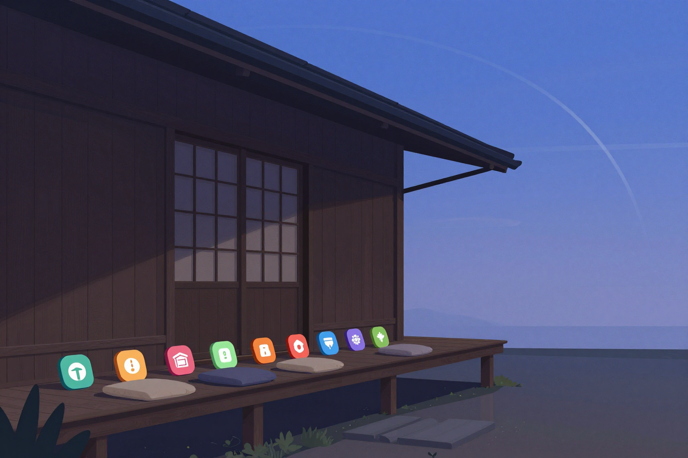

# Engawa

<p align="center">
  
</p>

<!-- The version badge is matched by hand to manifest.json's version (no tags, so no API-driven badge) -->
<p align="center">
  
  
  
  
  
  
</p>

An Arc-style sidebar, in Chrome's side panel.

An *engawa* (縁側) is the wooden veranda at the edge of a Japanese house — a place where things sit quietly at your side. That's where this extension keeps your tabs.

It recreates, as a Chrome side-panel extension, the things that made Arc's sidebar good. The panel uses Arc's vocabulary: the icon grid at the top is **Favorites**, the row list below it is **Pinned Tabs**.

- **Favorites (grid)**: your most-used sites as a grid of icons (up to 20 by default). Tiles are 44–56px squares and the column count adapts to the panel width. Like Arc, each favorite reuses a single dedicated tab.
- **Pinned tabs (with folders)**: a row-style list — Arc's per-space pinned tabs. They can be grouped into folders, and each also reuses a single dedicated tab.
- **GitHub live folders**: automatically lists your open pull requests and the PRs awaiting your review, with CI and review state shown as colors and tags. Each PR opens in its own dedicated tab (opened once, then reused), so switching is instant — no reload. When a PR leaves the list (merged, closed), its tab isn't closed; it returns to the Today section. Works with github.com and GitHub Enterprise Server.
- **Today**: a vertical list of your window's ordinary tabs (Arc's Today). Click to switch, × to close, drag to reorder (reflected in Chrome's tab strip too). Chrome split-view pairs fold into a single row, and you can create a split just by dropping one row onto another, or drag a single pane out (Chrome 155+). Splits can also live as a single item in pinned tabs or favorites (favorites show 2 panes in one tile; drop a tile onto the middle of another to split, Option-drag a pane to take it out. A favorite split pins both tabs if "pin favorites" is on).
- **Archive**: tabs you haven't looked at in a while are closed automatically and kept in an archive you can reopen anytime (Arc's auto-archive). The Today cleanup button (box with a down arrow) also archives every non-visible tab by hand.

No dependencies, Manifest V3, vanilla JS.

The UI (side panel, extension name, context menus, tooltips) follows Chrome's display language. English and Japanese catalogs ship in the box; other languages fall back to English (`default_locale`). There is no in-extension language switch — on macOS, Chrome's display language comes from System Settings > General > Language & Region.

## Install (local)

1. Clone this repository
2. Open `chrome://extensions` in Chrome and turn on **Developer mode** (top right)
3. **Load unpacked** and select the cloned directory
4. Open the side panel via the toolbar icon or `Alt+S`

## GitHub integration setup

1. Open settings from the slider button in the panel's bottom bar
2. Enter the hostname (leave it as github.com; for GHES enter just the hostname like `github.example.co.jp`)
3. Enter a Personal Access Token
   - classic token: `repo` scope (to include private repositories)
   - fine-grained token: Pull requests **Read** on the target repositories
4. Press **Save & refresh**. For GHES, accept the host-access permission dialog

The token is stored under a separate `githubToken` key in `chrome.storage.local` and never leaves this Chrome profile.
Favorites, pinned tabs and your settings are stored in `chrome.storage.sync` and follow your Google account across Chrome installs — the token is the one setting deliberately kept out of sync.

## Usage

| Action | How |
|---|---|
| Add current tab to favorites | Header ＋, `Alt+Shift+P`, or the page's right-click menu |
| Add a link to favorites | Right-click menu on the link, or drag & drop onto the grid |
| Reorder / delete / rename | Drag a tile — others flow aside in real time and it lands where you drop (Esc cancels mid-drag). Delete with × after entering edit mode via the pencil button; Esc exits edit mode. Rename by double-click (works outside edit mode too): an input appears under the tile — Enter commits, Esc cancels |
| Open a favorite / pinned tab | Click — switches to that item's dedicated tab. If the dedicated tab is showing and has navigated elsewhere, clicking again returns it to the registered URL (the second click of a double-click opens rename instead of moving the tab) |
| Open a PR | Click — opens the PR's dedicated tab (adopts an existing tab with the same URL), then just switches from the second time on. Re-clicking while that tab is shown returns to the PR page; arriving from another tab's Files changed etc. doesn't move it. Hovering an open PR shows ×, which closes just the tab (the item stays). PR tabs are not Chrome-pinned |
| Open in a separate new tab | ⌘-click or middle-click (bypasses the dedicated tab) |
| Refresh GitHub now | Refresh button (rotating arrow) |
| Collapse a folder | Click the folder name (state is saved) |
| Import Arc favorites & pins | Settings > "Import from Arc" (below). With zero favorites it's also reachable from the grid's hint |
| Pin a tab (list) | The ＋ next to "Pinned tabs". Folder button creates a folder. Drag to reorder; drop a tab row onto a folder to move inside / drag it out (works outside edit mode). Delete via × in the heading pencil's edit mode (separate from favorites'). Rename by double-click — the spot becomes an input (Enter commits, Esc cancels). Click a folder name to collapse |
| Today tabs | Click to switch, × or middle-click to close, drag to reorder. ＋ opens a new tab |
| Create a split view | Drag a Today row onto the middle of another row — left half puts it left, right half right (no extra tab). Near the top/bottom edges it's a normal reorder |
| Split rows | A pair folds into one row with a grip on its left edge. Click a pane to switch, its × or middle-click closes just that tab (the rest becomes normal tabs). Dragging the grip reorders the pair, keeping the split |
| Take one pane out of a split | Drag a pane out of a split row and drop it elsewhere (between rows, onto another row's middle for a new split, into pinned tabs / favorites). Esc cancels. Same for pinned split rows |
| Pin a split / make it a favorite (drag) | Drag a Today split row (by its left grip) onto the pinned list or favorites grid — it becomes a split item (favorites: one tile with 2 panes) without growing tabs. Dropping a pinned split row or split favorite back into Today returns it as a live split; items also move between pinned and favorites keeping their pane assignments |
| Combine pinned rows into a split item | Drop a pinned row onto the middle of a sibling row (left half → dropped goes left, right half → right). Can't combine with folder rows, split rows, or rows in another folder. If the partner's dedicated tab is closed, only the data changes — no new tab |
| Open a split item | Clicking a pane of a split row opens both in split view with that pane focused (only the missing panes open — no extra tabs). Clicking the grip or gap focuses the visible pane (left if none). ⌘-click / middle-click opens that pane's URL in a separate tab |
| Rename / delete a split item | Double-click a pane to rename that pane (items have no own name). The edit-mode × (one per row) deletes the item and both tabs return to Today as a split |
| Pin / favorite a Today tab (drag) | Drag a Today row up onto the pinned list (between rows, inside a folder, or at the end over empty space) or favorites (between tiles, or at the end). Its tab becomes the dedicated tab as-is — nothing extra opens. No edit mode needed |
| Unpin / un-favorite (drag) | Drag a pinned row or favorite tile into Today. If its dedicated tab is open it lands as that Today tab; otherwise a new tab opens there (the item isn't deleted — it returns to being a Today tab) |
| Move favorites ⇄ pinned (drag) | Drop a favorite tile onto the pinned list, or a pinned row onto the favorites grid (edit mode not required). Inserts at the drop position, keeping its dedicated tab. Favorites keep their Chrome-pinned state; pinned items stay unpinned |
| Clean up tabs at once | The Today cleanup button (box with down arrow) — archives everything except visible and Chrome-pinned tabs. A visible split keeps both panes (unavailable in Incognito) |
| Browse the archive | The box button in Today. Click an entry to reopen, × to delete it |

The dot left of a PR is its CI state (green: passing, red: failing, yellow: running, gray: none, outline only: draft).
The review-request count also shows on the extension icon's badge.

### Icons

Favorites and pinned tabs show each site's icon as Chrome remembers it, saved inside the extension. A site Chrome has never opened gets an initial-letter tile, replaced by the real icon after the first visit (sites whose dedicated tab redirects elsewhere use the redirect target's icon). When importing from Arc you can reuse Arc's own icons via step 4 above.

Each favorite tile's background is a light wash of the icon's dominant color (same idea as Arc favorites — it distinguishes neighbors by color). Black/gray icons and multicolor ones like Slack's get a neutral tile; whitish icons brighten in the light theme and darkish ones in the dark theme so they don't drown. Turn it off in settings: "Tint favorite tiles with the icon color". With several favorites sharing one icon (e.g. different pages of one service), the second onward shift background hue by 12° and alternate lightness by 4%.

Each tile's bottom edge faintly shows the start of its title in a thin bold face behind the icon (as many leading characters as fit; service-name suffixes like " - Google Docs" are dropped). A renamed favorite uses its custom name. Disable in settings: "Show short names on favorites".

While the GitHub token is unset, the GitHub section shows only a pointer to settings. Folders whose matching PR count is zero are hidden.

### Appearance (theme, color & background)

Settings > "Appearance" changes the panel's colors and background, applied instantly — no save button (other windows' panels follow too).

- **Theme**: Auto (follow OS light/dark, default) / Light / Dark
- **Sidebar color**: 6 color themes (sakura, amber, matcha, sora, fuji, grape) plus Neutral — like Arc's space colors, they retint the whole panel (background gradient, tiles, borders and text shades) with a palette hand-tuned for each of light and dark. Independent of the accent color
- **Accent color**: 7 choices (indigo, blue, teal, purple, pink, orange, graphite) for buttons and selection, each kept readable per theme
- **Background image**: pick an image file for the panel background, with opacity (0% = the image as-is, default 60%), anchor (9 positions), repeat (none / both / horizontal / vertical), and size (cover / fit width / original). "Original" comes with a scale slider (10–400%, default 100%) that works whether or not the image repeats, so tiled images can grow or shrink. Images up to 1.5 MB are stored as-is (animated GIFs and SVGs included); larger ones are shrunk to a 2560px-long-edge WebP. Anything still over 3 MB after shrinking, and formats Chrome can't display (TIFF, HEIC…), aren't saved
- **Background texture**: the grainy noise layered over the background can be switched off in settings ("Background texture")

### Pinned tabs

- Same dedicated-tab model as favorites: click switches to a dedicated tab, nothing piles up. They don't appear in Today and auto-archive never touches them. Not Chrome-pinned (so the pinned-tab strip doesn't overflow)
- Folders nest as deep as you like. Dropping a tab row onto a folder (or its open children) moves it to the folder's end; onto the folder's top edge places it before the folder. A row inside a folder leaves for the parent level when dragged above the folder row or below the child's end. Folder rows themselves reorder only within their level — they can't nest by drag
- The whole list lives in one 8 KB sync-storage item, so ~40–50 items is the practical ceiling depending on URL/title length
- There is no equivalent of Arc's Spaces divider. Chrome can't isolate login state per space the way Arc does, so Spaces aren't implemented — use separate Chrome profiles when you need separate logins

### Today & auto-archive

Tabs that aren't dedicated (favorites / pinned / GitHub) list vertically in Chrome's tab order (Arc's "pinned and Today" layout).

- Auto-archive is on by default: tabs unseen for 12 hours are closed and kept in the archive. Settings offer 1 hour to 1 week, or off
- Exempt: Chrome-pinned tabs, dedicated tabs (favorites/pinned/GitHub), each window's visible tab, audible tabs, and Incognito tabs (per Chrome's guidance, no Incognito browsing data is stored). A window never ends up empty
- Split pairs act as a pair. A visible split keeps both panes; an unseen split closes only when both panes qualify (same for the cleanup button)
- Tabs with unsaved input get Chrome's "leave this site?" prompt; cancelling keeps the tab and suspends its auto-archive candidacy until you next see it
- Right after Chrome starts or the extension is installed, the clock restarts — old tabs never close out of nowhere
- The archive keeps the latest 300 entries, stored only inside this Chrome install

### Live icons

While a favorite's or pinned item's dedicated tab is open, its row shows the tab's *current* favicon instead of the saved icon — Gmail's unread count and Slack's badge dot appear on tiles and rows, just like Arc. Closing the tab reverts to the saved icon.

### Tab handling (Arc-style)

Like Arc's favorites and live folders, pages opened from the sidebar reuse a *dedicated tab* — clicking never multiplies tabs.

- Each favorite and pinned item owns one dedicated tab. Clicking switches to it; if closed, it reopens at the registered URL. Following links inside doesn't break the bond — once the tab has wandered off the registered URL, clicking again returns it there
- Each PR owns one dedicated tab (keyed by its URL). The first click opens (or adopts a URL-matching tab) and reuses it thereafter — no reload on switching. When a PR leaves the list (merged, closed, review request withdrawn), the bond drops and the tab stays open as an ordinary Today tab (subject to normal auto-archive). Hover × on an open PR closes just that tab. Turning off the "Dedicated tab per PR" setting restores the old behavior of finding any URL-matching tab
- Favorites' dedicated tabs are Chrome-pinned by default (pinned items and PRs are not — see below). They line the left edge of the tab strip as small icons, visually apart from ordinary tabs. Disable in settings
- Closing a dedicated tab keeps the item; the next click reopens it at the registered URL
- Deleting a favorite unpins its dedicated tab back to normal — only tabs the extension itself pinned; tabs you pinned stay put
- Dedicated tabs come only from URL-matching tabs or freshly opened ones. A different page of the same site you pinned yourself (e.g. a GitHub notifications tab) is never adopted. Single items never adopt split panes (pinning would dissolve the split). Split items only adopt live, unassigned split pairs whose two URLs match exactly
- ⌘-click and middle-click always open a separate new tab, bypassing the dedicated tab

Dedicated-tab assignments are remembered per browser session. After a Chrome restart they're re-bound automatically by matching each dedicated tab's last URL or the registered URL (favorites: pinned tabs only when the pin setting is on; pinned items and PRs match ordinary tabs too). If auto-archive runs before the panel opens, the same rebinding prevents dedicated tabs from being closed. Discarded (slept) tabs by Memory Saver keep their assignment.

### Import from Arc

Arc favorites (the grid atop its sidebar) import into the favorites grid; each Space's pins import into the pinned list.

1. Open settings and press "Choose file…" under "Import from Arc"
2. In the file dialog press ⌘⇧G, paste this path and open it (Library is hidden in Finder)

```text
~/Library/Application Support/Arc/StorableSidebar.json
```

1. Candidates appear grouped like "Favorites" and "<Space name> pins"; check what you want and press "Import N selected". Each group shows its destination (Favorites / Pinned tabs)
2. (Optional) To reuse Arc's icons, pick the `SidebarItemsFaviconCache` folder next to that file via "Choose icon folder…" above the candidate list — applies to already-registered sites too. Accept Chrome's permission dialog (nothing is uploaded)

- URLs already registered show as "already a favorite" / "already pinned" and can't be selected
- Arc favorites go to the grid; each Space's pins land in the pinned list as a folder named after the Space (a single Space flattens). Candidates display as "folder / title"
- If the total would exceed the favorites limit, the limit is raised automatically (shown beforehand)
- Favorites and pinned tabs each live in one 8 KB sync-storage item — roughly 40–50 items each depending on URL/title lengths. Selections beyond that disable the import button
- Files are only read inside the browser — nothing is sent anywhere. Arc can stay running
- Verified against Arc on macOS; the Windows file layout is unconfirmed

## Structure

```text
manifest.json    Extension definition (MV3, side_panel, commands, permissions, default_locale)
background.js    GitHub GraphQL polling, favorite-adding shortcut & context menus, auto-archive
sidepanel.html   Side panel UI (strings injected from messages.json via data-i18n* attributes)
sidepanel.css    Styles (light / dark, sidebar color themes, accent colors)
sidepanel.js     Grid & folder rendering, settings screen
appearance.js    Appearance: applies theme (light/dark), color tint & accent before first paint, background images, settings "Appearance"
i18n.js          Thin chrome.i18n wrapper (t / tn / localizeDocument)
arc-import.js    Pure functions that parse Arc's StorableSidebar.json into import candidates (incl. Arc icon filename derivation)
icons.js         Saving & rendering favorite/pinned icons (Chrome favicon detection, initial tiles, Arc icons, tile background color)
color.js         Pure function picking a dominant color from icon pixels
layout.js        Pure function mapping panel width to grid columns
reorder.js       Real-time flowing reorder (shared by favorites, pinned tabs, Today)
split-items.js   Pinned split items: data (normalization), Chrome-side assembly (assembleSplit), click-to-open, Today round-trips, combining
pinned.js        Pinned tab list (with folders)
split-items-ui.js Rendering of pinned split rows; pane extraction & combine-target detection
today.js         Today section & archive screen
split.js         Today's split-view rows; split create/extract/move-as-pair
_locales/        Translation catalogs <lang>/messages.json (en = default_locale, ja bundled)
scripts/         Dev scripts (not needed to run the extension; need Node.js / Python 3)
                 check-i18n.mjs: translation-key consistency / test-arc-import.mjs: Arc parser tests
                 test-color.mjs: dominant-color tests (pass a .png to render a tile preview)
                 test-layout.mjs: grid-column tests / make-icons.py: icon generation / make-hero.py: README hero generation
                 e2e/: headless-Chrome E2E tests
icons/           Icons
assets/          README images (hero.png is generated by make-hero.py)
```

### Adding / checking translations

1. Copy `_locales/en/messages.json` to `_locales/<locale>/messages.json` and translate each `message`. Only `uiLocale` takes the language's BCP 47 tag (e.g. `de`). Leave `placeholders` untouched.
2. Run the consistency check — every referenced key exists in all locales, no unused keys, placeholders match across locales:

```sh
node scripts/check-i18n.mjs
```

1. Reload the extension at `chrome://extensions`.

### E2E tests

Loads the extension into a disposable-profile headless Chrome and actually drives icons, dedicated tabs, and Arc import. Your everyday Chrome and profile are never touched. Requires access to github.com; on a Mac with Arc data it also verifies import.

```sh
python3 scripts/e2e/e2e.py "$PWD"          # icons, dedicated tabs, Arc import
python3 scripts/e2e/e2e_refresh.py "$PWD"  # icon refresh after navigating, redirects
python3 scripts/e2e/e2e_owned.py "$PWD"    # detailed dedicated-tab behavior, unauthenticated display
python3 scripts/e2e/e2e_reorder.py "$PWD"  # edit-mode reorder (no network)
python3 scripts/e2e/e2e_today.py "$PWD"    # Today, archive, auto-archive, live icons
python3 scripts/e2e/e2e_pinned.py "$PWD"   # pinned tabs, folders, list import, legacy-data migration (no network)
python3 scripts/e2e/e2e_dnd.py "$PWD"      # Today ⇄ pinned/favorites drags, favorites ⇄ pinned moves (no network)
python3 scripts/e2e/e2e_pr_tabs.py "$PWD"  # dedicated tab per GitHub PR (no network)
python3 scripts/e2e/e2e_split.py "$PWD"    # Today splits: single-row display, drag split/extract/pair-move, pair cleanup (no network, Chrome 155+)
python3 scripts/e2e/e2e_split_items.py "$PWD"  # pinned split items: Today round-trips, combine/extract, click-reopen, races (no network, Chrome 155+)
python3 scripts/e2e/e2e_appearance.py "$PWD"   # theme, sidebar color, accent color, background image (no network)
python3 scripts/e2e/e2e_settings_sync.py "$PWD"  # settings sync area, local-only token, legacy migration (no network)
```

GitHub data comes from the GraphQL `search` API:

- Own PRs: `is:pr is:open archived:false author:@me`
- Review requests: `is:pr is:open archived:false review-requested:@me` (settings can switch to `user-review-requested:@me`)

## Limitations

- Chrome's side panel can't be force-pinned open by an extension; you can just leave it open
- Extensions can't turn the tab strip itself vertical
- Split creation/reordering uses the Chrome 155+ extension APIs (`chrome.tabs.createSplit` / `unsplit`). Chrome splits cap at 2 tabs and can't pair pinned+normal tabs or tabs in different groups (no 3+ way Arc-style splits)
- No extension API moves tabs without breaking their split, so pair reordering dissolves and recreates the split (custom split widths may not survive recreation)
- Only extension-pinned tabs can be unpinned out of a favorite split (self-pinned tabs stay pinned). If an unpinned dedicated tab sits inside your tab group, pinning it would remove it from the group — the extension reports instead of splitting/pinning. Post-restart split recreation happens on click. Self-made half-pinned pairs can't be adopted (both stay open and it reports). Arc imports treat splits as two separate items. An older version reading split items written by a newer one renders them distorted, like folders (mixed-version multi-machine use isn't supported)

## License

MIT. Some UI icons (`ui-icons.js`) derive from [Lucide](https://lucide.dev) (ISC) and Feather (MIT) — noted at the top of that file.
